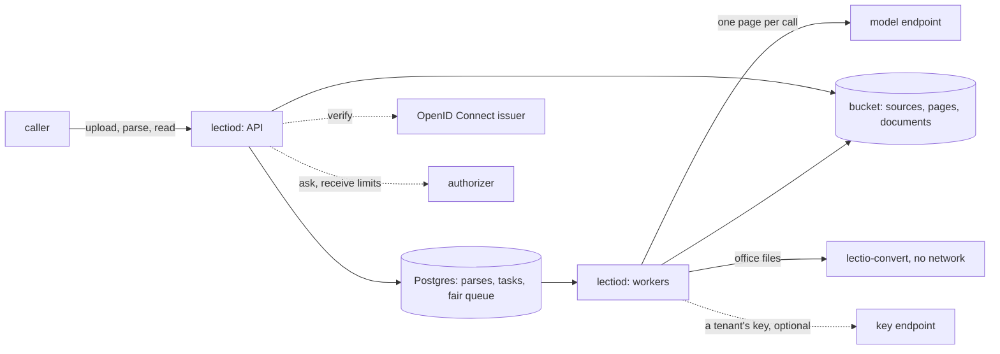

# Lectio

**A control plane that turns a file into a structured document.** Lectio
takes a PDF, an office document, a spreadsheet, or a scan and returns
its content as addressable objects: pages, the blocks on each page with
their kind and position, tables with their cells, and fields shaped by a
schema the caller supplies, each pointing at the blocks it was read
from. Pages are read by a vision-language model behind one interface,
so the model is a line of configuration.

What Lectio owns is the work around the model call. A parse is a graph
of small tasks kept in Postgres: one task prepares the file, one reads
each page, and the rest assemble the document. A worker that dies
loses nothing but its lease. A page that was read is never read again.
Tenants share the workers and the model's rate limit by weight, with an
interactive class ahead of a batch class, and no tenant can queue its
way past another.

[](https://github.com/latere-ai/lectio/actions/workflows/verify.yml)
[](https://github.com/latere-ai/lectio/releases)
[](go.mod)
[](LICENSE)

## Status

Lectio is before 1.0: a minor release may still change the API, the
Reader and Policy documents or the configuration, and its section in the
[changelog](CHANGELOG.md) says what changed and what an operator must
do. The [releases page](https://github.com/latere-ai/lectio/releases)
lists every release with its two signed images, `lectiod` and
`lectio-convert`, and its deploy tree. Lectio has had no external
security audit; [SECURITY.md](SECURITY.md#what-is-protected) lists what
it commits to and the test that holds each commitment.

Two servers run. The development server is the whole parsing path in
one process with nothing durable. The durable server keeps parses and
their tasks in Postgres and bytes in an S3 bucket, with the API and the
workers as separate processes.

| Area | Built | Designed, not built yet |
|---|---|---|
| Parsing | a parse as a graph of tasks in Postgres, in which a killed worker loses only its lease and a page read once is never read again; failed pages read again; a parse's pages and progress streamed as events | streaming assembly |
| Files | PDFs and images through a reader; text, Markdown, CSV, Word documents and Excel workbooks from the file itself; presentations, rich text, OpenDocument text and legacy Word files through the conversion sidecar; uploads and fetching by URL | HTML and XML read from the file itself |
| Results | the document, a page, a block or chunks, as JSON or Markdown, chosen when read; figures described on request; fields extracted in the shape of a schema, each citing its blocks; sets of parses extracted alike | extraction in the development server |
| Readers | any endpoint of the OpenAI chat completions API, a gateway included; a PDF's own text; chains of readers; readers changed while the server runs; one key for everyone or a key per tenant from a key endpoint | |
| Tenants | groups sharing workers and the model's rate limit by weight, an interactive and a batch class, limits on pages per parse and per day, meters by the hour, what waits and what runs per group | limits on submits per minute and on tokens per parse |
| Callers | tokens from any OpenID Connect issuer; every request asked of an authorizer, or of the owner policy without one | |
| Running it | `lectiod` in the roles `api` and `worker`; the two images; Kubernetes manifests | |
| Observability | over OTLP, the log, a span and the request metrics of every API request, and a span for each outbound call | a trace per parse and task, the processing record, and the queue and pool metrics |

[specs/README.md](specs/README.md) is the design, and each spec says
under Implementation status what of it is built.

## Quickstart

The development server runs the whole parsing path in one process with
nothing durable. With no reader configured, it reads text, Markdown,
CSV, Word documents and Excel workbooks from the file itself, so it
needs no model. Install Go (the version
`go.mod` names), `make`, `git` and `curl` first, then upload a CSV file,
parse it, and read it back as Markdown:

```sh
git clone https://github.com/latere-ai/lectio.git && cd lectio && make build
LECTIO_DEV=true LECTIO_ADDR=127.0.0.1:8080 out/lectiod > out/dev.log 2>&1 &
pid=$!
until curl -sf http://127.0.0.1:8080/v1/openapi.yaml > /dev/null; do sleep 1; done

api=http://127.0.0.1:8080/v1 auth='Authorization: Bearer dev'
printf 'name,qty\nbolts,12\nnuts,40\n' > out/sample.csv
file=$(curl -s -H "$auth" --data-binary @out/sample.csv "$api/files?name=sample.csv" \
  | sed -n 's/.*"id":"\(fil_[^"]*\)".*/\1/p')
parse=$(curl -s -H "$auth" -H 'Prefer: wait=30' -H 'Content-Type: application/json' \
  -d "{\"source\":{\"file\":\"$file\"}}" "$api/parses" | sed -n 's/^{"id":"\(prs_[^"]*\)".*/\1/p')
curl -s -H "$auth" "$api/parses/$parse/document?format=markdown"

kill "$pid"
```

The last request prints the table:

```
| name | qty |
| --- | --- |
| bolts | 12 |
| nuts | 40 |
```

[Running it locally](docs/local.md) goes on to the durable stack on one
machine, office files through the conversion sidecar, and a reader that
sends PDF pages and images to a model.

## How it fits



- **A caller** uploads a file or names a URL, asks for a parse, and
  reads the result, with a token from your OpenID Connect issuer.
- **The API**, `lectiod` in the role `api`, verifies the token, asks
  your authorizer what the caller may do and what the parse is held to,
  keeps the file in the bucket, and records the parse and its tasks in
  Postgres.
- **The workers**, `lectiod` in the role `worker`, take tasks from the
  fair queue in Postgres, render each page, and send it to the model
  endpoint through a reader. A format read from the file itself needs
  no model, and neither does a PDF page that a reader of the `text`
  adapter reads from the words the file holds.
- **The model endpoint** is any endpoint of the OpenAI chat completions
  API, a gateway included. A key endpoint you run can give each
  tenant's pages a key of its own, so the gateway meters each tenant.
- **The conversion sidecar**, `lectio-convert`, turns presentations,
  rich text and older office formats into a PDF or a Word document with
  an office suite, in a container with no network.
- **Your authorizer** decides who may do what and sets the limits;
  without one, a built-in owner policy lets each caller act on what it
  created.

A language model, a search index, or a workflow cannot use a scanned
contract or a 400-page report as a file. It needs the text in reading
order, the tables as tables, and a way to point back at the place on
the page a value came from. Hosted vision-language models read a page
well, and a single call is easy. Reading ten thousand pages for forty
tenants through a rate-limited API, without losing work to a restart
and without one tenant's backlog stalling the rest, is the part that
takes a system. Lectio is that system, and nothing else: it does not
serve models, store files beyond the parse, or hold accounts.

## Documentation

| | |
|---|---|
| [Running it locally](docs/local.md) | the development server, and the durable stack on one machine, ending in a parse |
| [Install](docs/install.md) | the images, Postgres, the bucket, the roles and probes, the conversion sidecar, the cluster manifests, and upgrading |
| [Configuration](docs/configuration.md) | every setting, its default, and what refuses a start |
| [Readers](docs/readers.md) | the Reader and Policy documents, a PDF's own text, changing readers while the server runs, and whose key reads a page |
| [API](docs/api.md) | files, parses and their results, events, figures, fields and sets, and the errors to branch on |
| [Writing an authorizer](docs/authorizer.md) | the question Lectio asks, the vocabulary, the limits an allow carries, and the owner policy |
| [Security](docs/security.md) | what Lectio guarantees, what it sees and keeps, and what it does not defend |
| [Quality](docs/quality.md) | the corpus a reader is measured on, the measures and the bars |
| [`api/openapi.yaml`](api/openapi.yaml) | the full API reference, also served at `/v1/openapi.yaml` |
| [Changelog](CHANGELOG.md) | what changed in each release, and what an operator must do |

[`docs/README.md`](docs/README.md) is the index, by reader.

## Contributing

[`CONTRIBUTING.md`](CONTRIBUTING.md) is how to build and test a change
and where code belongs. [`SECURITY.md`](SECURITY.md) is what the
project protects and where to report a vulnerability; please do not
open an issue for one.

## License

Apache-2.0. See [LICENSE](LICENSE).
