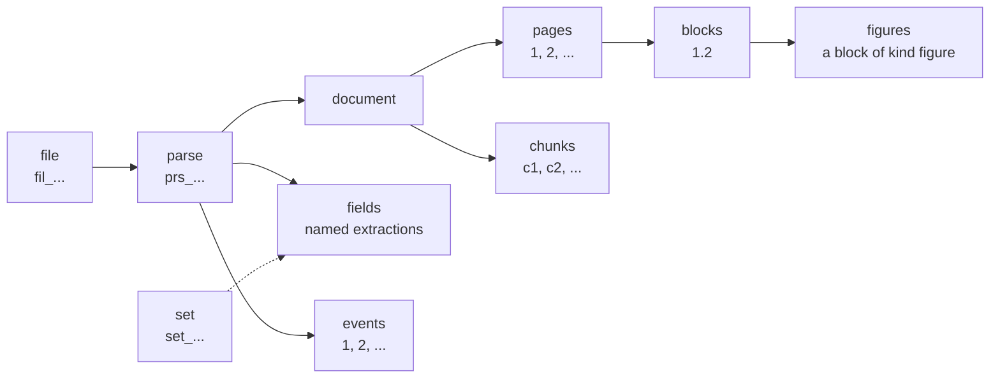
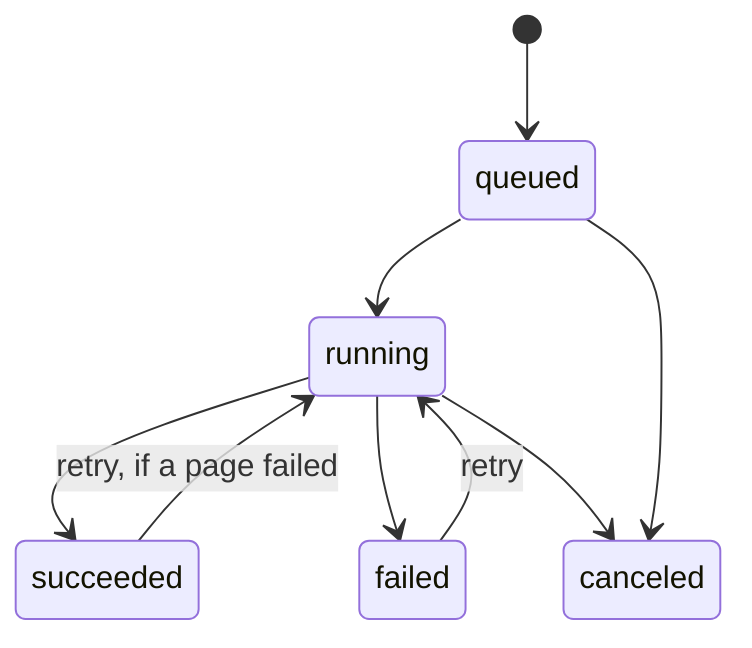

# API

This page is for someone who writes a client of `lectiod`. It says what the objects are, which requests a client makes to get a result, which errors to branch on, and which limits a client meets. Every route, parameter and field is in the OpenAPI document [`api/openapi.yaml`](../api/openapi.yaml), which a running server also serves at `/v1/openapi.yaml`, and this page does not repeat it.

The examples use the development server of `make run`, which takes the token `dev`:

```sh
api=http://localhost:8080/v1
auth='Authorization: Bearer dev'
```

## Calling the API

| Question | Answer |
|---|---|
| Base path | `/v1`. A deployment may mount the API under another path with [`LECTIO_BASE_PATH`](configuration.md#server). |
| Authentication | `Authorization: Bearer <token>` on every request but two. The scheme is matched without regard to case. `GET /v1/openapi.yaml` and `GET /healthz` take no token, and `/healthz` is outside the base path. |
| Which token | The durable server verifies a token from an issuer listed in [`LECTIO_OIDC_ISSUERS`](configuration.md#callers), addressed to the audience `lectio` unless [`LECTIO_OIDC_AUDIENCE`](configuration.md#callers) names another. A development server that lists no issuer takes one static token, `dev` unless [`LECTIO_DEV_TOKEN`](configuration.md#server) names another, as the subject `dev`. |
| Who owns what | The caller is the issuer and the `sub` of its token joined by a pipe, such as `https://issuer.example\|alice`. A caller owns the files, parses and sets it creates. Who may read or change anything else, and what a caller is held to, is decided as [authorizer.md](authorizer.md) says. |
| No token | `401 missing_token`. A token that is refused is `401 invalid_token`. |
| Bodies | JSON, except an upload, which is the file. A member the contract does not describe is refused with `400 unknown_field`. |
| `Lectio-Version` | A response header on every answer, an error included. It names the release that wrote the answer, such as `v0.8.0`, or `dev` for an unstamped build. During a rolling update two releases answer behind one address, and this says which. |
| Request ids | `lectiod` does not put a request id in its answers. It passes the request's `X-Request-Id` to the authorizer for correlation when that header is 1 to 128 visible ASCII characters, and a generated id otherwise. |
| `Prefer: wait=<seconds>` | On `POST /parses` and `POST /parses/{parse}/figures`, holds the answer until the work ends or the wait runs out. A larger number is taken as the most the server holds, [60 seconds](configuration.md#fixed-values). A value that is not a positive whole number is ignored. The answer then carries `Preference-Applied: wait=<seconds>`. |
| `Idempotency-Key` | On `POST /parses`. The same key from the same caller with the same body returns the parse the first request made. The same key with another body is `409 idempotency_conflict`. |

## The objects



| Object | Id | What it is |
|---|---|---|
| File | `fil_` and 26 characters | The bytes a caller uploaded, or fetched from a URL, with the type Lectio detected. The same bytes uploaded again by the same caller are one file, and the upload answers `200` and not `201`. A file is kept for a time and `expires_at` says until when. |
| Parse | `prs_` and 26 characters | One read of one file. A submit always makes a parse of its own. Its `state` is `queued`, `running`, `succeeded`, `failed` or `canceled`, and its `progress.stage` is `queued`, `preparing`, `reading`, `assembling` or `done`. |
| Document | The parse's id | What the parse produced, as an index: its pages without their blocks, the tables that continue across pages, the outline, and usage. |
| Page | A number from 1 | One page of the file, with a `state` of `pending`, `succeeded`, `failed` or `skipped`. `source` says who produced its blocks: `reader` (a model read the page's image), `native` (the format carries its own structure) or `text_layer` (built from the text a PDF carries, with no model call). |
| Block | `<page>.<order>`, such as `1.2` | A paragraph, heading, table, figure or another region of a page. `1.2` is the second block in reading order on page 1. A ref is stable for the life of the parse and `order` counts from 1 on each page. `kind` is one of a closed set, `box` is `[x0, y0, x1, y1]` as fractions of the page with the origin at the top left, and `box` is `null` for a page whose format has no layout. |
| Chunk | `c1`, `c2`, and so on | A run of blocks as text, for retrieval. It is computed when it is read, so its id names its place in that answer and means nothing in another. It lists the `pages` and the `blocks` it covers. |
| Figure | The ref of its block | A block of kind `figure`. Once described, it carries `description` and `figure.type`. |
| Field | A name you choose | One extraction: an object in the shape of a schema, filled from the document, with the blocks each value was read from. The name is lowercase letters, digits, `_` and `-`, at most 63 characters, and starts with a letter. |
| Event | A number that only grows within a parse | One line of the stream of a parse: a `page`, `progress` or `state` event. |
| Set | `set_` and 26 characters | A stored definition of an extraction, made before any file is read and asked of each parse that joins it. |

### Choosing a result when it is read

A parse reads a file once. What a client sees of the result is chosen by each read, and no read runs the parse again or calls a model:

| To get | Ask for |
|---|---|
| The document as an index | `GET /parses/{parse}/document` |
| The content in reading order | `GET /parses/{parse}/document?format=markdown` or `format=text`, optionally with `pages`, `tables` (`auto`, `markdown` or `html`), `repeated` (`once`, `keep` or `drop`, for running headers and footers) and `page_breaks` |
| One page, or one block | `GET /parses/{parse}/pages/1`, `GET /parses/{parse}/blocks/1.2` |
| Every block, one JSON object per line | `GET /parses/{parse}/blocks`, optionally with `pages` |
| Chunks for retrieval, one JSON object per line | `GET /parses/{parse}/chunks?by=section` or `by=page`, with `max_chars` |
| A page or a block as an image | `GET /parses/{parse}/pages/1/image`, `GET /parses/{parse}/blocks/4.1/image` |

The `pages` parameter uses the syntax of a submit's `pages`: numbers and ranges separated by commas, counted from 1, where an open range such as `5-` runs to the end. A page image exists only for a page a reader saw, and a block image only for a block that has a `box` on such a page. A page read natively has neither.

## Which files are read

The type is decided from the file, not from what the caller said. Lectio looks at the content first (the leading bytes, and the part names inside a zipped office package), then at the extension of `name`, then at the `Content-Type`. Plain text, Markdown and CSV cannot be told apart by content, so their extension decides.

| Kind of file | How it is read |
|---|---|
| PDF, PNG, JPEG, TIFF | Through a reader, a page at a time. |
| Plain text (`.txt`), Markdown (`.md`), CSV (`.csv`), Word (`.docx`), Excel (`.xlsx`, `.xlsm`) | From the file itself, with no model. A text or Markdown file, and a Word document, is one page; a CSV file is one page holding one table; a workbook is one page per sheet. Their blocks have no `box`. |
| PowerPoint (`.pptx`, `.ppt`), Keynote (`.key`), rich text (`.rtf`), OpenDocument text and presentations (`.odt`, `.odp`) | Converted to PDF by the conversion sidecar, then through a reader. |
| Legacy Word (`.doc`) | Converted to `.docx` by the sidecar, then from the file itself. |
| Signed container (`.p7m`) | Opened to the file inside, which is detected again. |
| Excel 97 to 2003 (`.xls`) | Refused at upload with `415 unsupported_media_type`: save the workbook as `.xlsx`. |
| HTML and XML | Recognized and stored, and a parse of one fails with `unsupported_media_type`: this build does not read them. |
| Anything else | `415 unsupported_media_type`. |

A server with no sidecar ([`LECTIO_CONVERTER_URL`](configuration.md#conversion)) stores a presentation, and a parse of it fails with `unsupported_media_type`. The failure is on the parse and not on the upload, because the upload only learns the type.

## The flows

### Upload a file

```sh
curl -s -H "$auth" --data-binary @report.csv "$api/files?name=report.csv"
```

The body is the file, or a `multipart/form-data` form with one part named `file`. The answer is the file: `id`, `size`, `sha256`, `media_type`. A source can instead be a URL in the submit, `{"source":{"url":"https://..."}}`. Only `https` addresses that resolve to public addresses are fetched, except hosts named in [`LECTIO_FETCH_ALLOW`](configuration.md#limits), and a URL that cannot be fetched is `422 source_unreachable`.

### Parse, and wait or poll

```sh
curl -s -H "$auth" -H 'Content-Type: application/json' \
  -d '{"source":{"file":"fil_..."}}' "$api/parses"
```

This answers `202` with the parse. The options of a submit (which `pages`, a pinned `reader`, `class` and `priority`, `allow_failed_pages`, a `deadline`, `labels`, an `origin`, and `reuse`) are in the OpenAPI document. Two need a word here:

- A page that an earlier parse of the same caller read whole, from the same bytes with the same readers, is taken from that read, and no model is called for it. It says `reused: true`, and the parse counts it in `progress.pages_reused`. `"reuse": false` turns this off.
- `allow_failed_pages` is how many pages may fail while the parse still ends `succeeded`.

To wait, add `-H 'Prefer: wait=30'`: the answer is `200` when the parse ended within the wait and `202` when it did not. To poll, `GET /parses/{parse}` until `state` is `succeeded`, `failed` or `canceled`. A parse that failed says why in `error.code`, from the codes [below](#codes-on-a-parse-a-page-or-an-extraction).



`POST /parses/{parse}/cancel` stops a parse that has not ended and answers `409 already_terminal` for one that has. What was read stays readable.

### Follow a parse as events

```sh
curl -sN -H "$auth" "$api/parses/prs_.../events"
```

The stream is server-sent events: a `page` event as each page settles, with its `page`, its `state` and its `error` when it failed, and the parse's `progress` and `state` as they change. It ends after the `state` of a parse that has ended. Every event has an id. The server ends a stream it has held for 5 minutes, and a proxy may end one sooner: connect again with `Last-Event-ID` set to the last id you saw and the stream continues after it, with nothing sent twice, on any replica and after a restart. A `retry` field names the delay to wait. A stream that says nothing for 15 seconds sends a comment line, so a proxy with an idle timeout above that leaves it open.

### Read a page while the parse runs

A page is readable as soon as it was read.

```sh
curl -s -H "$auth" "$api/parses/prs_.../pages/1"
curl -s -H "$auth" "$api/parses/prs_.../blocks/1.2"
```

A page not read yet is `409 page_not_ready`, and the same request succeeds later. A page the parse does not read, or one it ended without reading, is `404 page_not_found`. `GET /parses/{parse}/pages` lists every page of the selection with its state, and `GET /parses/{parse}/blocks` answers with the pages read so far. The document, and the chunks, are readable once the parse has assembled its pages, which a parse with failed pages still does. Before that they are `409 document_not_ready`.

### Read the failed pages again

A parse that ended with failed pages keeps the pages it read. One request reads the failed ones again and no other:

```sh
curl -s -X POST -H "$auth" "$api/parses/prs_.../retry"
```

The answer is `202` with the parse `running`, in the group it was submitted to and held to that group's bounds. A parse that has not ended is `409 not_terminal`. A parse with no failed page, one that was canceled or ran out of time, and one with an extraction or a figure run still queued or running is `409 conflict`. A group that already holds as many parses as it may is `429 queue_full`, and a group whose day does not hold the failed pages is `402 budget_exhausted`.

### Describe figures

```sh
curl -s -X POST -H "$auth" -H 'Prefer: wait=30' "$api/parses/prs_.../figures"
curl -s -H "$auth" "$api/parses/prs_.../figures"
```

A reader that finds a figure says where it is. This asks a describer what each figure shows, for a parse that has ended, and reads no page again. The optional body names `pages`, a `describer`, and `redo` to describe figures that already have a description. The description is then on the figure's block, and `GET /parses/{parse}/figures` lists every figure with the run that described them. Only a figure that has a `box` on a page read from an image is described. The answer is `202`, or `200` when the run ended within the wait. A parse that has not ended is `409 not_terminal`, a run while one is in flight is `409 conflict`, and a request whose pages hold more figures than one run describes is `413 too_many_pages` and starts nothing.

### Extract fields with a schema, and resolve their citations

```sh
curl -s -X POST -H "$auth" -H 'Content-Type: application/json' "$api/parses/prs_.../fields" \
  -d '{"name":"invoice","schema":{"type":"object","required":["number"],
       "properties":{"number":{"type":"string"},"total":{"type":"number"}}}}'
curl -s -H "$auth" "$api/parses/prs_.../fields/invoice?resolve=true"
```

The first answers `202` with the extraction `pending`. It may be asked while the parse still runs; it waits for the parse to end. Poll the second until `state` is `succeeded`, with `data` in the shape of the schema, or `failed`, with `error`. A value the document does not state is left out and never guessed, so an object that lacks a member the schema requires fails with `schema_not_satisfied`.

`citations` maps a JSON pointer into `data` to the refs of the blocks that value was read from. With `resolve=true` each ref comes with its `page` and its `box`, so a client can draw the source of a value without reading the block. The schema is checked when the request arrives: one that is not draft 2020-12, does not describe an object at its root, or uses a keyword outside the list in the OpenAPI document is `400 invalid_schema`. `PUT /parses/{parse}/fields/{name}` asks the same name again, with another schema or after a failure, and reads no page again.

An extraction and a figure run are tasks of the parse's group, as its pages are: they take the group's turn, are held to its `max_running`, wait for room in their reader's pool, and are in `/usage` and `/queue`. They count no page against the group's pages for a day. One that has not ended `LECTIO_MAX_DEADLINE` after it was queued is given up. Which reader extracts or describes is the Policy's to say, as [Readers](readers.md#the-policy-document) shows.

### Delete

```sh
curl -s -X DELETE -H "$auth" "$api/parses/prs_..."
curl -s -X DELETE -H "$auth" "$api/files/fil_..."
```

Both answer `204`. A parse that has not ended is `409 not_terminal`: cancel it first. A file that a parse which has not ended reads is `409 not_terminal` too. Deleting a parse removes everything it wrote.

### Read usage, and what waits

```sh
curl -s -H "$auth" "$api/usage?by=reader&interval=day"
curl -s -H "$auth" "$api/queue"
```

`/usage` sums the pages read, the model calls made for them and the tokens those calls took in and gave out, by `group`, `owner` or `reader`, over hours or days in UTC. A call that failed is counted as the call it was. With no `from` it covers the last 24 hours, or the last 30 days with `interval=day`.

`/queue` lists each group with its weight, its bounds, its parses that have not ended and its queued and running tasks per class, the same for each of its projects, and each reader's pool: the calls in flight against its bound, whether its breaker admits calls, and the keys a rate limit paused.

Under the owner policy a caller is answered its own usage and its own group, and a subject of `LECTIO_ADMIN_SUBJECTS` everyone's. With an authorizer, `usage.read` and `queue.read` are asked of it, with the `owner` and the `group` the request names.

## Errors

Every error has the same shape. Branch on `code`. `message` is one fixed sentence for a person, and `details` is for a developer:

```json
{ "error": { "code": "unknown_field", "message": "The request has a field that is not recognized.",
  "details": { "reason": "the body has a member \"mode\" the contract does not describe", "retryable": false, "field": "mode" } } }
```

`details.retryable` says whether the same request may succeed later. `details.reason` says what happened in this instance, and is absent for some errors. `details.field` names the member of the request the error is about, when there is one. An address that is not routed is `404 not_found`, and one routed under another method is `405 method_not_allowed` with an `Allow` header. Any route may answer `401`, `403`, `500` and `503`.

| Status | Code | When |
|---|---|---|
| 400 | `invalid_request` | The body is not one JSON object, is over the body limit, or has a value of the wrong type; a query parameter, a header or a member is out of range; a priority is outside what the caller's allow permits. `details.field` names it. |
| 400 | `unknown_field` | The body has a member the contract does not describe. |
| 400 | `invalid_pages` | A `pages` selection does not parse, or names no page of the file. |
| 400 | `invalid_schema` | An extraction's or a set's schema is not accepted. |
| 400 | `reader_not_found` | A named `reader`, `describer` or `extractor` is not configured, or the default the caller's allow names is not. |
| 401 | `missing_token` | The request carries no bearer. |
| 401 | `invalid_token` | The bearer is refused, or is not the development token. |
| 402 | `budget_exhausted` | A submit when the caller's group has no page left of its day, and a retry whose failed pages do not fit what is left. |
| 403 | `forbidden` | The authorizer denied a create, a list, a read of usage or the queue, or a change of readers; or the caller may not use the `class` it asked for. |
| 403 | `reader_not_permitted` | The request names a reader, describer or extractor outside the readers the caller may pin. |
| 404 | `not_found` | Nothing is routed at the address, an extraction has no such name, or no reader has that name. |
| 404 | `file_not_found`, `parse_not_found`, `set_not_found` | No such object, or one the caller may not act on. The two are not told apart, so an id cannot be probed for what someone else owns. |
| 404 | `page_not_found` | The parse does not read that page, or ended without reading it, or the page has no image. |
| 404 | `block_not_found` | The page holds no such block, the block has no `box`, or its page was not read from an image. |
| 405 | `method_not_allowed` | The address does not take that method. |
| 409 | `page_not_ready` | The page has not been read yet. Retryable. |
| 409 | `document_not_ready` | The parse has not assembled its pages. Retryable. |
| 409 | `conflict` | The request conflicts with what is there: a retry with nothing to read again, a second extraction of a name, a figure run while one runs, a change while work on the same object is queued or running, a set of the same name. |
| 409 | `idempotency_conflict` | The `Idempotency-Key` was used with a different body. |
| 409 | `not_terminal` | The parse has not ended, for a delete, a retry or a figure run; or a parse that has not ended reads the file. |
| 409 | `already_terminal` | A cancel of a parse that has ended. |
| 413 | `file_too_large` | The upload or the fetched file is over the limit. |
| 413 | `too_many_pages` | A figure run would describe more figures than one run does. |
| 415 | `unsupported_media_type` | The type of an upload or a fetched file is not one Lectio reads. |
| 422 | `source_unreachable` | A URL source could not be fetched. Retryable. |
| 422 | `capability_unsupported` | The authorizer's allow carries a limit this server does not enforce. |
| 429 | `queue_full` | The caller's group already holds as many parses that have not ended as it may. Retryable. |
| 500 | `internal` | Something went wrong on the server. Its detail is logged and not returned. Retryable. |
| 501 | `not_implemented` | The route is not built in this server, as [the last section](#what-the-development-server-does-not-build) lists. |
| 503 | `authorizer_unavailable` | The authorizer gave no decision, so the request failed closed. Retryable. |

The contract also lists `rate_limited` (`429`, retryable). No route answers it today, so a client need not handle it.

### Codes on a parse, a page or an extraction

A parse, a page, a figure and an extraction that failed carry an `error` with a `code` and a `detail`, apart from the status of any request. The codes are `file_not_found`, `file_too_large`, `invalid_pages`, `document_corrupt` (the file cannot be opened as its type), `unsupported_media_type`, `too_many_pages` (the parse selects more pages than its limit allows), `source_unreachable`, `page_unreadable`, `figure_unreadable`, `reader_unavailable`, `reader_not_permitted`, `budget_exhausted`, `deadline_exceeded` (the parse did not end by its deadline), `schema_not_satisfied` and `internal`.

## Limits a client meets

| Limit | Where it is set |
|---|---|
| Largest file, uploaded or fetched, and largest page count of a document | [`LECTIO_MAX_FILE_BYTES`](configuration.md#limits) and [`LECTIO_MAX_PAGES`](configuration.md#limits). An authorizer may lower either for a caller, as [authorizer.md](authorizer.md#limits-an-allow-carries) says. |
| Longest `deadline` of a parse, and the deadline of one submitted with none | [`LECTIO_MAX_DEADLINE`](configuration.md#limits) |
| How long `Prefer: wait` holds an answer | [Fixed at 60 seconds](configuration.md#fixed-values) |
| How long a file, and a parse with its results, are kept | [`LECTIO_FILE_RETENTION`](configuration.md#retention) and [`LECTIO_PARSE_RETENTION`](configuration.md#retention). An authorizer may shorten either. |
| Pages per day, parses waiting or running, tasks running at once, priority, classes, readers | Set per group by the authorizer, as [authorizer.md](authorizer.md#limits-an-allow-carries) says. Under the owner policy they are the defaults of [`LECTIO_GROUP_DEFAULTS`](configuration.md#workers). |
| How long an event stream is held, and how often it says something | Fixed: 5 minutes, and a comment line after 15 seconds without an event |

The contract itself fixes these bounds, which no setting changes:

| Bound | Value |
|---|---|
| JSON body of a request | 1 MiB (1,048,576 bytes) |
| `Idempotency-Key` | 255 bytes; kept for 24 hours in the durable server |
| File `name` | 255 bytes |
| `limit` of a list | 1 to 200, 50 unless set; the next page is `cursor` set to `next_cursor` |
| `labels` of a parse | 16 keys, values at most 256 bytes |
| `languages` of a parse | 8 tags of at most 35 bytes |
| Extractions of one parse | 64 |
| Figures one run describes | 1,000 |
| `instructions` of an extraction | 4,000 characters |
| Schema of an extraction | 64 KiB, nested at most 16 levels |
| Intervals one `/usage` read spans | 1,000 |
| Parses in one set | 10,000 |

The OpenAPI document states the other bounds of a schema, such as the keywords it takes.

## What the development server does not build

The development server (`LECTIO_DEV=true`) keeps everything in memory and has no task store. It authenticates the request and asks its question as the durable server does, and then answers `501 not_implemented` for every route built over the task store:

- `POST /parses/{parse}/retry` and `GET /parses/{parse}/events`;
- `GET /usage` and `GET /queue`;
- the four routes of an extraction: `POST` and `GET /parses/{parse}/fields`, and `GET` and `PUT /parses/{parse}/fields/{name}`;
- the eight routes of sets, under `/sets`;
- `PUT` and `DELETE` on `/readers/{name}` and on `/policy`, since a development server stores no reader.

It reads, describes figures, cancels, deletes and lists. Its idempotency keys do not expire, and a parse submitted with no deadline has none. It also refuses an allow that sets `max_running`, `max_queued`, `pages_per_day` or `retention_seconds` with `422 capability_unsupported`.

## The full reference

[`api/openapi.yaml`](../api/openapi.yaml) lists every route, parameter, schema and status, and is held equal to the server by a test. The designs behind it are [`specs/003-api.md`](../specs/003-api.md) for the API and [`specs/012-identity-and-authorization.md`](../specs/012-identity-and-authorization.md) for callers. [local.md](local.md) runs the same requests against a server on one machine.
