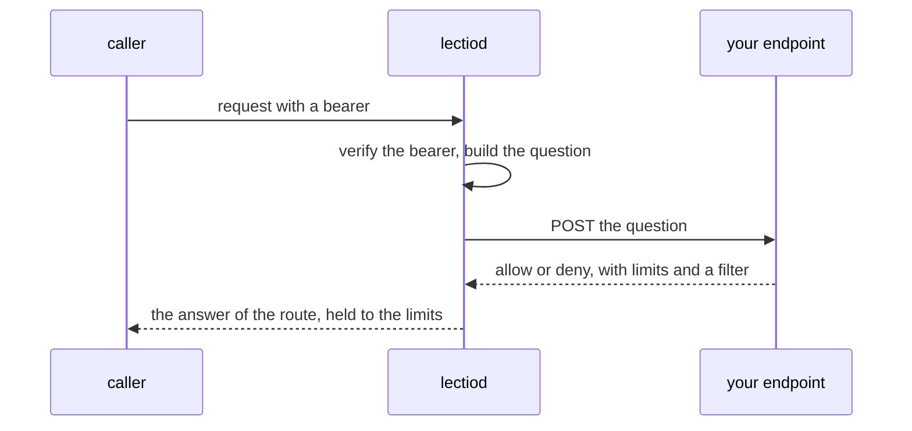

# The authorizer

This page is for someone who writes the endpoint `LECTIO_AUTHORIZER_URL` points at, and for someone who wants to know what `lectiod` decides on its own when no endpoint is set. It gives the question `lectiod` asks, the actions it can ask, the answer it reads, what it does when the answer does not come, and the policy that decides without an endpoint. The design is [`specs/012-identity-and-authorization.md`](../specs/012-identity-and-authorization.md), and the Go package an endpoint is written against is [`authorizer`](../authorizer).

Lectio holds no accounts, no roles and no plans. It verifies who a caller is, asks your endpoint what the caller may do, and enforces the limits the answer carries.



## How `lectiod` reaches the endpoint

Two settings, both described in [configuration.md](configuration.md#callers):

| Setting | Meaning |
|---|---|
| `LECTIO_AUTHORIZER_URL` | The endpoint. Every question is one `POST` to exactly this URL, with nothing appended. |
| `LECTIO_AUTHORIZER_TOKEN` | The bearer sent as `Authorization: Bearer <token>`. Setting the URL without it stops the start. |

Each call sends `Content-Type: application/json` and `Accept: application/json`, with the question as the body. The endpoint answers `200` with a JSON body, as [The answer](#the-answer) says. Only a process that serves the API asks: role `api`, role `all` and the development server. A worker does not.

When the server starts it sends the endpoint a probe: a question with no subject, the action `parse.read` on a `Parse` whose id is `00000000-0000-0000-0000-000000000001`. Every authorizer denies that id for every subject and action. An endpoint that allows it does not read what it is asked, and the server refuses to start. An endpoint that does not answer is named in the log and the server starts, since every request then fails closed. The wait at start is in [configuration.md](configuration.md#fixed-values).

## The question

The body is one JSON object:

| Member | Type | Meaning |
|---|---|---|
| `subject` | string | The caller: the issuer, with its trailing slash removed, a pipe, and the token's `sub`. `https://issuer.example\|alice`. The development token is the subject `dev`. |
| `issuer` | string | The issuer alone. Empty for the development token. |
| `sub` | string | The `sub` alone. |
| `claims` | object | Every claim of the verified token, as the issuer wrote it. `{}` when there are none. Lectio reads none of them: an organization, a team or a plan is whatever your issuer stamps and your endpoint reads. |
| `action` | string | One of [the vocabulary](#the-vocabulary). |
| `resource` | object | What the action acts on, as one flat object. `kind` and, for a stored object, `id`, sit beside the members the action sends. |
| `request.id` | string | The request's `X-Request-Id` when it is 1 to 128 visible ASCII characters, and a generated id otherwise. For correlation only. |
| `request.ip` | string | The peer address as `lectiod` sees it, without the port. Behind a proxy it is the proxy's. |
| `request.user_agent` | string | The request's `User-Agent`. |

The address and the user agent are inputs a policy may decide from. The id is not one.

An example, for a submit:

```json
{
  "subject": "https://issuer.example|alice",
  "issuer": "https://issuer.example",
  "sub": "alice",
  "claims": { "iss": "https://issuer.example", "sub": "alice", "aud": "lectio", "org": "acme" },
  "action": "parse.create",
  "resource": {
    "kind": "Parse",
    "class": "interactive",
    "priority": 0,
    "reader": "vision",
    "labels": { "batch": "q3" },
    "origin": { "store": "s3", "path": "reports/q3.pdf" },
    "pages": 12
  },
  "request": { "id": "req_6c1f", "ip": "203.0.113.7", "user_agent": "curl/8.7.1" }
}
```

A resource member that `lectiod` does not know for a request is left out and never sent empty, so an endpoint can tell a parse with no pinned reader from one whose reader is the empty string.

| Resource member | Type | Meaning |
|---|---|---|
| `id` | string | The id of a stored parse, file or set. Absent on a create: the object does not exist until the create is allowed. |
| `owner` | string | The owner the stored object is recorded under. No request can name an owner today, so a create sends none, and the allow says whose the new object is. |
| `class` | string | `interactive` or `batch`, as submitted. Always sent for a parse. |
| `priority` | integer | As submitted, 0 when the request names none. Always sent for a parse. |
| `reader` | string | The reader the parse pins. Absent when the routing policy decides. |
| `labels` | object | The parse's labels, string to string. Absent when it has none. |
| `origin` | object | `store`, `path` and `version`, each present only when the submit gave it. |
| `pages` | integer | How many pages the parse selects. Absent while that is not known: a submit knows it only for a selection with no open range, and a stored parse once its pages were counted. |
| `size` | integer | A file's size in bytes. An upload sends it only when the request declares a length, so an upload in a form sends none. |
| `media_type` | string | An upload: the type the request declared, with its parameters dropped. A stored file: the type Lectio detected. |
| `group` | string | The fairness group a usage or queue read names. Absent when it names none. |
| `name` | string | A set's name, or a reader's. A question about the routing policy names `policy`. |

## The vocabulary

Every question asks one action, and an action acts on one kind. The constants, the kinds and the members are in the package `authorizer`: `authorizer.Actions()`, `authorizer.Kind(action)` and `authorizer.Fields(action)`. `authorizer.Vocabulary()` is the whole table, which a client refuses an unknown action against and `latere.ai/x/pkg/authz/server` validates against. An action string never changes and never disappears.

A member is sent when it is known, as the table above says. A route that asks about a stored object reads the object first by its id alone, and sends the object as it is stored.

| Action | Kind | Asked by | Resource members sent |
|---|---|---|---|
| `parse.create` | `Parse` | `POST /parses` (a submit), and the requests that queue model work on a stored parse: `POST /parses/{parse}/retry`, `POST /parses/{parse}/figures`, `POST /parses/{parse}/fields`, `PUT /parses/{parse}/fields/{name}` | `id`, `owner`, `class`, `priority`, `reader`, `labels`, `origin`, `pages`. A submit sends no `id` and no `owner`. |
| `parse.read` | `Parse` | every read of a parse and of what it produced: `GET /parses/{parse}`, `/events`, `/document`, `/pages`, `/pages/{page}`, `/pages/{page}/image`, `/blocks`, `/blocks/{ref}`, `/blocks/{ref}/image`, `/figures`, `/chunks`, `/fields`, `/fields/{name}` | the same eight |
| `parse.list` | `Parse` | `GET /parses` | none |
| `parse.cancel` | `Parse` | `POST /parses/{parse}/cancel` | the same eight |
| `parse.delete` | `Parse` | `DELETE /parses/{parse}` | the same eight |
| `file.create` | `File` | `POST /files` | `owner`, `size`, `media_type` |
| `file.read` | `File` | `GET /files/{file}` | `id`, `owner`, `size`, `media_type` |
| `file.delete` | `File` | `DELETE /files/{file}` | the same four |
| `reader.list` | `Reader` | `GET /readers`, `GET /readers/{name}`, `GET /policy` | none |
| `reader.update` | `Reader` | `PUT /readers/{name}`, `PUT /policy`, `DELETE /policy` | `name` |
| `reader.delete` | `Reader` | `DELETE /readers/{name}` | `name` |
| `usage.read` | `Usage` | `GET /usage` | `owner` and `group`, as the request names them |
| `queue.read` | `Queue` | `GET /queue` | `group`, as the request names it |
| `set.create` | `Set` | `POST /sets` | `owner`, `name`. A create sends no `owner`. |
| `set.read` | `Set` | `GET /sets/{set}`, `GET /sets/{set}/parses` | `id`, `owner`, `name` |
| `set.list` | `Set` | `GET /sets` | none |
| `set.update` | `Set` | `PUT /sets/{set}`, `PUT /sets/{set}/parses/{parse}`, `DELETE /sets/{set}/parses/{parse}` | `id`, `owner`, `name` |
| `set.delete` | `Set` | `DELETE /sets/{set}` | `id`, `owner`, `name` |

`GET /openapi.yaml` and `GET /healthz` ask nothing. `parse.list` and `set.list` are decisions like the others: their allow carries a filter that narrows the list. Lectio names no action whose answer is a page of its own shape.

Some things about what an action covers:

- `parse.create` about a stored parse is the question of a retry, a figure run and an extraction. The work stays the parse's owner's, so the `owner` of that allow is not read. A figure run and an extraction are held to its `readers` and `reader`. A retry takes no limit from its allow: the parse stays in the group it was admitted to, held to that group's bounds as they stand.
- Joining a parse to a set asks `set.update` about the set alone. The parse must be the set owner's, and the work is held to the limits of the parse's owner.
- The reach of `set.read` and `set.update` is the set owner's parses that join the set. An authorizer that decides `parse.create` or `parse.read` more narrowly than by owner decides the set actions as narrowly.
- A token minted from a personal access token or a service account key carries grants in the claim `authorization_details`, and names an action qualified by `lectio`, such as `lectio:parse.read`. Lectio forwards the claims and applies no grant itself when your endpoint decides. An endpoint built on `latere.ai/x/pkg/authz/server` narrows its answer by the grants. One that is not must do it to honor them.

## The answer

The endpoint answers `200` with one JSON object:

| Member | Type | Meaning |
|---|---|---|
| `allow` | boolean | Required. An answer without it is no answer. |
| `reason` | string | Read on a deny. It becomes the developer detail of the error, as `the authorizer denied the request: <reason>`, in `details.reason`. It is never in `message`, the sentence a person reads. Use a short word, such as `not_owner`. |
| `ttl` | integer | Seconds an allow may be remembered. See [Caching](#caching). |
| `limits` | object | What the request is held to. See [Limits an allow carries](#limits-an-allow-carries). |
| `filter` | object | Narrows a list, as below. |

A deny:

```json
{ "allow": false, "reason": "not_owner" }
```

An allow of a submit, with limits:

```json
{ "allow": true,
  "limits": { "owner": "https://issuer.example|alice", "group": "org:acme", "weight": 4,
              "max_queued": 20, "pages_per_day": 5000, "classes": ["interactive"],
              "max_file_bytes": 104857600, "retention_seconds": 604800 } }
```

An allow of a list, with a filter:

```json
{ "allow": true, "filter": { "owners": ["https://issuer.example|alice"], "labels": { "team": "ops" } } }
```

What a deny becomes, for the caller:

| Question | Deny is |
|---|---|
| About a stored parse, file or set (it carries an `id`) | The `404` of its kind: `parse_not_found`, `file_not_found` or `set_not_found`. A denied object and a missing one are one answer, so an id cannot be probed for what someone else owns. |
| A create, a list, a read of usage or the queue, a change of readers or the policy | `403 forbidden`. |

A route asks one question, and its deny does not say which question it was.

### Filters

`filter` narrows and never widens: a row `lectiod` would not list without it is not listed with it. It is read on `parse.list`, `set.list`, `usage.read` and `queue.read`.

| Member | Effect |
|---|---|
| `owners` | Only rows owned by one of them. On `queue.read` they are read as the groups the caller may see, which is exact when a group is its owner. An empty list lists nobody. Absent narrows nothing. |
| `labels` | Only parses that carry every label with the value. They apply beside the labels the caller itself asked for, and a label the caller asked for with another value lists nothing. A set carries no label, and a usage or queue read none, so a filter with labels leaves nothing on those. |

## Limits an allow carries

The `limits` object is how your endpoint tells Lectio what a caller's work is held to. Every member is optional. A member the object leaves out leaves the server's own value in force, which is the one in [configuration.md](configuration.md#limits), [retention](configuration.md#retention) and [`LECTIO_GROUP_DEFAULTS`](configuration.md#workers). Lectio enforces what it is told and stores no plan.

The Go type is `authorizer.WireLimits`. It is the type `lectiod` decodes, so an endpoint writes it:

```go
limits := authorizer.WireLimits{Group: &group, MaxQueued: &hundred}
```

| Member | Type, unit | What it does | Absent, or 0 |
|---|---|---|---|
| `owner` | string | The owner the new parse, file or set is recorded under. Every later read or change of it asks about that owner. Read on a create only: an allow about a stored parse does not move it. | The caller's subject. |
| `group` | string | The fairness group the parse joins: the unit callers share one queue and one budget in. Callers whose allows name one group are served as one. | The owner. |
| `weight` | integer, 1 to 1000 | The group's share of service against other groups. | Absent or 0 keeps the default. |
| `project` | string | The project inside the group, which divides the group's own work. | The group's own project. |
| `project_weight` | integer, 1 to 1000 | The project's share of what its group is served. It moves service between the projects of one group and never between groups. | Absent or 0 keeps the default. |
| `max_running` | integer, tasks | How many tasks of the group may be leased at once. | Absent keeps the default. 0 is no cap, and lifts a default cap. |
| `max_queued` | integer, parses | How many parses of the group may be queued or running. A submit past it is `429 queue_full`. | Absent keeps the default. 0 is no cap. |
| `max_priority` | integer | Bounds a parse's `priority` on both sides: a submit names one from minus this to this. A priority outside is `400 invalid_request` on `priority`. | Absent keeps the default. 0 admits priority 0 alone. |
| `classes` | list of strings | The classes the caller may submit in. A class outside is `403 forbidden` on `class`. | Empty or absent is both. |
| `readers` | list of strings | The readers the caller may pin or name. A `reader`, `describer` or `extractor` outside is `403 reader_not_permitted`. | Empty or absent is all. |
| `reader` | string | The reader a request that names none is held to, for what it asks: its pages, its figures or its fields. One the server does not have is `400 reader_not_found`. A reader that cannot do what the request asks, such as one that cannot describe figures for a figure run, is not used. | The routing policy's. |
| `max_file_bytes` | integer, bytes | The largest file the caller may upload or name. A larger one is `413 file_too_large`, an upload refused as soon as its declared length is over, and a submit against a file or a URL's file checked when it is named. Lowers [`LECTIO_MAX_FILE_BYTES`](configuration.md#limits) and never raises it. | The server's. |
| `max_pages` | integer, pages | The most pages one parse may select. A parse that selects more fails with `too_many_pages` when its pages are counted, and reads none. Lowers [`LECTIO_MAX_PAGES`](configuration.md#limits) and never raises it. | The server's. |
| `pages_per_day` | integer, pages | How many pages the group's parses may count in one day, counted in UTC. A submit when the day is already spent is `402 budget_exhausted`. A parse whose selected pages do not fit what is left fails with `budget_exhausted` before it reads a page, and a retry whose failed pages do not fit is refused with it. An extraction and a figure run count no page. | Absent keeps the default. 0 is no budget. |
| `retention_seconds` | integer, seconds | How long the file, or the parse and its results, are kept. Lowers [`LECTIO_FILE_RETENTION`](configuration.md#retention) or [`LECTIO_PARSE_RETENTION`](configuration.md#retention) and never raises it. | The server's. |

How a number replaces the server's value, member by member: `owner`, `group`, `project`, `reader`, `classes` and `readers` replace it when not empty. `weight` and `project_weight` replace it when above 0. `max_running`, `max_queued`, `max_priority` and `pages_per_day` replace it whatever they are, 0 included, which is how an answer lifts a cap. `max_file_bytes`, `max_pages` and `retention_seconds` replace it only when above 0 and below the server's, or when the server sets none.

The group's weight, project and caps are written when a parse is submitted, so the group has the values of its latest submit.

### Which allows are read

| Action | Members read |
|---|---|
| `parse.create` | All of them. For a stored parse (a figure run or an extraction) `owner` is ignored and the work is held to `readers` and `reader`. A retry is held to none of them. |
| `file.create` | `owner`, `group`, `max_file_bytes`, `retention_seconds`. `group` is read and held by nothing: a file joins no queue. |
| `set.create`, `set.update` | `owner` (on a create), `readers` and `reader`: the owner a new set is recorded under, the readers an extractor the set names is held to, and the extractor a definition that names none takes. |
| Every other action | None. The `limits` of the allow are not read. |

### A limits object that cannot be held

| Object | Result |
|---|---|
| Does not parse as an object, holds a number below 0, a weight above 1000, an integer member above 2147483647, a `retention_seconds` above 9223372036, an empty name in `classes` or `readers`, or a `reader` that `readers` leaves out | The answer is no decision: `503 authorizer_unavailable`. A ceiling Lectio cannot read is not one it can hold. |
| Names a member this version does not know | `422 capability_unsupported`, naming it. A limit Lectio is handed and cannot enforce is a refusal and never a silent pass. |
| Sets a member the development server cannot hold (`max_running`, `max_queued`, `pages_per_day` or `retention_seconds`) to a value that changes what is in force | `422 capability_unsupported`, naming the member. A cap of 0, or a ceiling above the server's own, changes nothing and is not refused. |

`authorizer.DecodeLimits` reads an answer as `lectiod` does, so an endpoint's tests can hold their answers to it.

## Caching

The client keeps decisions in memory in each process, and the rules are fixed by the contract that `lectiod` and an endpoint share. They are not settings.

| Answer | Kept for |
|---|---|
| An allow | Its `ttl` in seconds. 60 seconds when the answer names none or a value of 0 or less, and at most 600 seconds. |
| A deny | 5 seconds. |
| No decision (an outage) | Never. |

Only a question about a stored object is kept, because it has an `id`. A create, a list, a read of usage or the queue, and a change of readers have none, so every one of them is asked. Limits changed at your endpoint therefore hold from the caller's next create. A question is kept under everything it carries but `request.id`, including the claims, the address and the user agent, and its limits are kept with it. The cache holds the 65,536 most recently used decisions. A change at your endpoint, such as a revoked access, reaches a kept question only when its time is up, so give an allow a `ttl` as short as a revocation may take.

A stream of events asks once, when it connects, and ends after 5 minutes, as the [API guide](api.md#follow-a-parse-as-events) says.

## Failing closed

Anything that is not a well-formed answer is no decision, and a request with no decision is `503 authorizer_unavailable` with `details.retryable` true. The detail names neither the endpoint nor its bearer. Nothing is done for the request, and nothing is cached.

| What happens | Result |
|---|---|
| The endpoint cannot be reached | One more try when the connection failed before a response began: refused, reset, closed without a response, or a dial timeout. Then `503`. |
| The endpoint is slow | A call, the retry included, is given 5 seconds. A call that times out after the request was sent is not tried again. Then `503`. |
| A status other than `200`, a body that is not JSON, a body with no `allow`, or a body over 64 KiB | `503`. |
| An allow whose `limits` cannot be read | `503`. |
| An allow with a member of `limits` this version does not know | `422 capability_unsupported`. |
| The question names an action outside the vocabulary | Refused before it is sent. It is a mistake in a handler, answered `500 internal`. |

The call timeout, the retry and the lifetimes above belong to the shared contract and have no setting. The start-up wait is in [configuration.md](configuration.md#fixed-values).

One thing an outage does not hide: a parse, file or set that does not exist is answered `404` before any question is asked, so while the endpoint is down an id that exists (`503`) can be told from one that does not (`404`).

## A minimal endpoint

`latere.ai/x/pkg/authz/server` is the scaffold of an endpoint. It checks the bearer, bounds the body, decodes the question, refuses an action outside the vocabulary with `400`, denies the probe, narrows an allow by the grants of the caller's token, and writes the answer. The endpoint supplies the `Decider`:

```go
package main

import (
	"context"
	"encoding/json/jsontext"
	"encoding/json/v2"
	"log"
	"net/http"
	"os"
	"time"

	"latere.ai/x/lectio/authorizer"
	"latere.ai/x/pkg/authz"
	"latere.ai/x/pkg/authz/server"
)

type decider struct{}

func (decider) Decide(_ context.Context, req authz.Request) (authz.Decision, error) {
	owner := req.Resource.String(authorizer.FieldOwner)
	switch {
	case owner != "":
		// A question about a stored object: only its owner may act on it.
		if owner == req.Subject {
			return authz.Decision{Allow: true, TTL: time.Minute}, nil
		}
		return authz.Decision{Reason: "not_owner"}, nil
	case req.Action == authorizer.ActionParseList, req.Action == authorizer.ActionSetList,
		req.Action == authorizer.ActionUsageRead, req.Action == authorizer.ActionQueueRead:
		// A list, and a read of usage or of the queue, ranges over the caller's own.
		return authz.Decision{Allow: true, Filter: &authz.Filter{Owners: []string{req.Subject}}}, nil
	case req.Action == authorizer.ActionParseCreate:
		// A submit: record the parse under the caller and hold it to 200 pages a day.
		perDay := 200
		limits, err := json.Marshal(authorizer.WireLimits{Owner: &req.Subject, PagesPerDay: &perDay})
		if err != nil {
			return authz.Decision{}, err
		}
		return authz.Decision{Allow: true, Limits: jsontext.Value(limits)}, nil
	case req.Action == authorizer.ActionFileCreate, req.Action == authorizer.ActionSetCreate,
		req.Action == authorizer.ActionReaderList:
		return authz.Decision{Allow: true}, nil
	}
	// Everything else, readers and the routing policy included, is denied.
	return authz.Decision{Reason: "not_allowed"}, nil
}

func main() {
	http.Handle("POST /authorize", server.New(server.Options{
		Bearer:     os.Getenv("AUTHORIZER_TOKEN"),
		Vocabulary: authorizer.Vocabulary(),
		Decider:    decider{},
	}))
	log.Fatal(http.ListenAndServe("127.0.0.1:9000", nil))
}
```

Start `lectiod` with `LECTIO_AUTHORIZER_URL=http://127.0.0.1:9000/authorize` and `LECTIO_AUTHORIZER_TOKEN` set to the same value as `AUTHORIZER_TOKEN`. `Bearer` and `BearerNext` both take a token, so a rotation is two deploys and no outage. An endpoint with neither answers `401` to everything. To hold an endpoint to the contract, run the shared conformance suite from a test:

```go
conformance.Run(t, url, token, conformance.WithVocabulary(authorizer.Vocabulary()))
```

## Without an endpoint: the owner policy

With `LECTIO_AUTHORIZER_URL` unset, `lectiod` logs `owner policy` at start and decides itself. A caller acts on what it owns, lists are narrowed to its own, the group is the owner, and no allow carries a limit, so every request is held to the server's own settings and a create is recorded under the caller's subject. The subjects in [`LECTIO_ADMIN_SUBJECTS`](configuration.md#callers), each written `<issuer>|<sub>`, may read every owner's parses, files, sets, usage and queue, and alone may store readers and set the routing policy. An admin reads and does not change: it cannot cancel, delete or retry another owner's parse, and cannot create in another owner's name.

The rows, in the order they are tried. The first that matches decides:

| # | Question | Answer |
|---|---|---|
| 1 | The probe id, from any subject | Deny, `probe` |
| 2 | No subject | Deny, `anonymous` |
| 3 | An action outside the vocabulary, or asked about another kind than it acts on | Deny, `unknown_action` |
| 4 | `reader.list` | Allow. The readers are the server's configuration and nobody's. |
| 5 | `reader.update` or `reader.delete` | Allow for an admin. Otherwise deny, `not_owner`. |
| 6 | `parse.read`, `file.read` or `set.read`, from an admin | Allow |
| 7 | `parse.list` or `set.list` | Allow, with a filter that narrows the list to the subject's own. No filter for an admin. |
| 8 | `usage.read` or `queue.read` that names no owner and no group | As row 7 |
| 9 | `usage.read` or `queue.read` that names an owner or a group | Allow for an admin, and when every name given is the subject. Otherwise deny, `not_owner`. |
| 10 | A stored object (it has an `id`) that carries no owner | Deny, `not_owner`. A stored object always has an owner, and an unfinished question is not read as a create. |
| 11 | Any action on a stored object whose owner is the subject | Allow |
| 12 | `parse.create`, `file.create` or `set.create` on an object that has no owner yet | Allow |
| 13 | Anything else | Deny, `not_owner` |

The answer of these rows is then narrowed by the grants the caller's token carries, if it is a token minted from a personal access token or a service account key. The narrowing turns an allow into a deny with the reason `grant`, and never a deny into an allow. A token whose grants cannot be read is denied.

Because a request cannot name an owner, a service that submits for its users needs an authorizer: under the owner policy every create is recorded under the caller's subject. Under the owner policy a submit's `priority` is 0 unless [`LECTIO_GROUP_DEFAULTS`](configuration.md#workers) names a `max_priority`.
