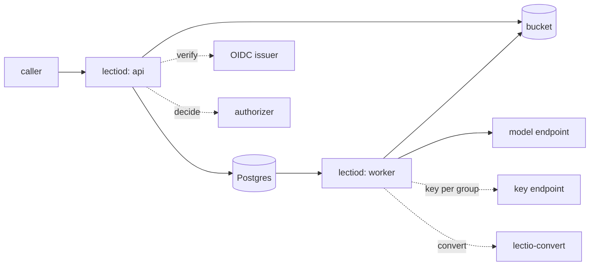

# Installing Lectio

For the operator who runs Lectio for other people. It answers what an
installation needs, what the two images are and how to check them, how
the database and the bucket are used, how the processes are told apart
and probed, how to install on a cluster, how to upgrade, and what a
production installation must have. To try Lectio on one machine first,
read [Running it locally](local.md).

## What an installation needs

| Need | Required | Notes |
|---|---|---|
| Postgres 16 or later | yes | Holds parses, tasks and the fair queue. Lectio does not run it. |
| An S3-compatible bucket | yes | Holds every byte: sources, page images, results. The bucket must exist: Lectio sends nothing at start, so a missing bucket shows on the first request that needs it. |
| An OpenID Connect issuer | yes, for the API | Callers sign in with a token the issuer signed for the audience the server answers to. A process in the role `worker` verifies no token and needs none. |
| A model endpoint | yes, to read pages with a model | Any endpoint that speaks OpenAI-compatible chat completions with image input, a gateway included, or a layout engine behind the `layout` adapter. A PDF that carries its text can be read with no model. See [Readers](readers.md). |
| An authorizer | optional | Decides what each caller may do and sets limits. Without one, the owner policy decides. See [The authorizer](authorizer.md). |
| A key endpoint | optional | Issues a model key per group, so a gateway attributes each tenant's spend. See [Whose key reads a page](readers.md#whose-key-reads-a-page). |
| The conversion sidecar | optional | Converts presentations, rich text and legacy word-processing files. Without it a parse of one fails with `unsupported_media_type`. See [The conversion sidecar](#the-conversion-sidecar). |
| Kubernetes 1.30 or later | for the manifests in `deploy/` | With a network plugin that enforces NetworkPolicy, egress included. Without one the policies refuse nothing and the sidecar has a network. |

A certificate authority of your own, for an issuer, an authorizer or a
key endpoint, is trusted the way the process trusts any: through the
system's roots or `SSL_CERT_FILE`.

## The images

A release publishes two images for linux/amd64 and linux/arm64.

| Image | Holds | Runs |
|---|---|---|
| `ghcr.io/<owner>/lectiod:<tag>` | the `lectiod` binary and the CA roots it needs, on a distroless base. No shell, no package manager, no office suite. | as user `65532`, with a read-only root file system and no capability. It writes no file. It listens on 8080 (the API) and 8081 (the probes). |
| `ghcr.io/<owner>/lectio-convert:<tag>` | the `lectio-convert` binary and an office suite without its graphical front end, with the fonts a converted page is drawn with, on a Debian base. | as user `65532`, with a read-only root file system and no capability, writing only under `/tmp`. It holds no credential and listens on 8090 or on a socket. |

`<owner>` is the account that cut the release: a fork's tag publishes
under the fork's namespace. Both images are signed, and each carries a
bill of materials and a provenance attestation. A release also attaches
`deploy-<tag>.tar.gz`, the [`deploy/`](../deploy/README.md) tree with both
images pinned to the release by digest. [Verifying a
release](../SECURITY.md#verifying-a-release) has the commands that check
the signatures, the attestations and the checksums. Run them before you
install a release.

To build the images yourself, from the repository root:

```sh
podman build -t lectiod .
podman build -f deploy/converter/Dockerfile -t lectio-convert .
podman run --rm lectiod version
```

`docker` takes the same arguments. The version `lectiod version` prints is
also on every answer of the API, in the response header `Lectio-Version`,
so a caller can tell which release answered while a rolling update runs
two at once. A proxy in front of the API that should not reveal it
removes the header there.

## The database

`lectiod` reads two URLs, and only `LECTIO_DATABASE_URL` is required.

- `LECTIO_DATABASE_URL` is the direct endpoint of the database. The API
  applies the schema over it, because the migrator holds a session lock
  across its statements.
- `LECTIO_DATABASE_POOL_URL` is the endpoint of a transaction-mode
  pooler. When it is set, the serving path of every role opens it and
  never the direct URL. Migrations never go through it. Lectio asks the
  pooler for nothing a transaction-mode pooler cannot give: its client
  describes each statement instead of keeping a prepared one on the
  connection.

[Storage settings](configuration.md#storage) lists both variables.

The schema is applied by the API at start, in the roles `api` and `all`.
With several replicas that start at once, the migrator's lock lets one
apply the schema while the others wait and find it applied. A process in
the role `worker` never migrates. Started before the schema is there, it
retries with a backoff for a bounded time and then exits
([`LECTIO_ROLE`](configuration.md#server) says how long), so a worker that a
scheduler restarts joins once the API has migrated.

A process opens the database only at the schema version its own release
carries. Two refusals follow, and each names the version:

- A Pod of an earlier release that starts or restarts against a newer
  schema does not come up.
- An API whose release carries older migrations than the schema stops
  with a message to run the release that wrote the schema.

Pods already running are not checked again, so they keep running until
they restart. [Upgrading](#upgrading) uses both facts.

Back the database up as you would any database that holds work in
progress: the parses and the queue are rows in it. The bytes of the
sources and results are in the bucket, so a restore needs the database and
the bucket from the same time.

## The bucket

`lectiod` needs a bucket, an endpoint, a region and a key pair, and does
not start with one missing: it names the variable
([Storage settings](configuration.md#storage)). Create the
bucket first.

- `LECTIO_S3_PATH_STYLE=true` addresses the bucket as the first segment of
  the path and not as a label of the host. A server reached by an address,
  and most servers that are not a cloud's own, need it.
- `LECTIO_BUCKET_PREFIX` is put before every key, so several
  installations can share a bucket.
- The key pair is the object store's, held by both roles. The API reads and
  writes results; the workers write what they read and remove what has
  expired.

How long files and parses are kept is set in
[Retention](configuration.md#retention), and what a deleted file leaves
behind is in [Security](security.md).

## Roles, the internal address and the probes

`LECTIO_ROLE` says what a durable process does.

| Role | Serves callers | Runs tasks | Applies the schema | Needs an issuer |
|---|---|---|---|---|
| `api` | on `LECTIO_ADDR` | no | yes | yes |
| `worker` | no | yes | no | no |
| `all`, the default | on `LECTIO_ADDR` | yes | yes | yes |

An installation runs the roles apart: one Deployment of `api` and one of
`worker`, which scale independently. The workers' count times
`LECTIO_WORKERS` is how many tasks the fleet runs at once
([Worker settings](configuration.md#workers)). The role `all` is for one
machine.



Every role serves its probes on `LECTIO_INTERNAL_ADDR`, never on the
public address, so a probe cannot be reached through the ingress.

| Path | Answers `200` when | What it checks |
|---|---|---|
| `/livez` | the process runs | nothing. It never reports an error and carries no text. |
| `/readyz` | every check passes; otherwise `503` with the failing check's name and error in the body | the database answers. For a worker, also that the task store answered one of its exchanges within a third of `LECTIO_TASK_LEASE`. |
| `/version` | always | the build's version, commit and time, as JSON. |

Each check is bounded by a short timeout. Neither a model endpoint nor the
key endpoint nor the object store is part of readiness. A worker whose key
endpoint is down stays ready: the pages that need a key wait in the queue,
and the worker runs every other task. A database that does not answer takes
the Pod out of rotation through `/readyz` and must not restart it, which is
why liveness is a separate path.

At start the API logs the mode in force, reads each issuer's keys and sends
the authorizer a probe. An issuer that does not answer is named and the
server starts, reading its keys when the first token arrives. An
authorizer that does not answer is named and the server starts, and every
request is refused with `503 authorizer_unavailable` until it answers. An
authorizer that allows the probe is refused: it does not read what it is
asked ([The authorizer](authorizer.md)).

The API's public listener also answers `GET /healthz`. A cluster's probes
go to the internal listener instead.

## Workers joining, stopping and being killed

Workers coordinate through the database alone, so they can be added,
stopped and killed while parses run.

- **Joining.** A new worker registers and is handed work at its next
  exchange. Nothing else changes.
- **Stopping.** On `SIGTERM` or `SIGINT` a worker claims nothing more and
  gives its running tasks `LECTIO_SHUTDOWN_GRACE` to finish. It settles
  what finished and gives the rest back to the queue at once, with no
  counter changed. Another worker takes them.
- **Being killed.** A worker that is killed loses its tasks when its lease
  runs out, after `LECTIO_TASK_LEASE`, and the workers that are left take
  them. A page that was read is never read again.

[Worker settings](configuration.md#workers) lists the lease, the grace and
the other timings. The API stops the same way: it stops accepting
connections and gives open requests `LECTIO_SHUTDOWN_GRACE` to finish. On a
cluster the Pod's termination grace must be longer than the grace plus the
API's `preStop` sleep, and an installation that raises
`LECTIO_SHUTDOWN_GRACE` raises it too
([deploy/README.md](../deploy/README.md#stopping-and-rolling)).

## The conversion sidecar

Presentations (`.pptx`, `.ppt`, `.odp`, `.key`), rich text (`.rtf`), open
document text (`.odt`) and legacy Word files (`.doc`) are converted before
they are read, by `lectio-convert`. A legacy Excel file (`.xls`) is refused
with or without it. The sidecar holds an office suite, which is a large
program that opens a file somebody else wrote, and a document can name
resources for that program to fetch. So the sidecar must have no network.
It cannot take the network from itself: whoever runs it does.
[SECURITY.md](../SECURITY.md#what-is-not-defended) says what is and is
not protected.

Point the workers at it with `LECTIO_CONVERTER_URL`
([Conversion settings](configuration.md#conversion)). The value is
`http://host:port`, or `unix:///path/to/socket` for a sidecar with no
network that shares a directory with the server.

| Where | How the sidecar has no network |
|---|---|
| One machine | The container runs with no network and listens on a socket (`LECTIO_CONVERT_ADDR=unix:/run/lectio/convert.sock`) in a volume that it shares with `lectiod`. [Running it locally](local.md) has the compose file. |
| A cluster | The component in `deploy/components/converter` gives the sidecar Pods of their own, since containers of one Pod share a network. Its policy names both directions and has no egress rule, so every connection out is refused, DNS included. The one ingress rule admits the workers' Pods. |

On a cluster the sidecar also holds no credential: it reads no ConfigMap and
no Secret, mounts no token, and the addresses of the namespace's Services
are kept out of its environment. Its root file system is read only, each
conversion writes under a bounded `/tmp`, and a conversion that outlasts its
time limit is killed. Only the workers call it.

A sidecar run on a laptop may listen on a port instead, which gives it a
network. That is for your own files and not for ones you do not trust.

## The cluster manifests

[`deploy/`](../deploy/README.md) holds Kustomize manifests. That page is the
reference for every object, port, probe and resource limit. This is what is
in the tree.

| Path | What it is |
|---|---|
| `base/` | both roles of `lectiod` as two Deployments, the Service of the API, the account both run as, a network policy for each role and the API's disruption budget |
| `components/converter/` | the conversion sidecar, as a component an overlay adds: its Deployment, Service, account and policies, and the one variable that gives the workers its address |
| `examples/generic/` | an installation without conversion: the base, and the two ConfigMaps with example values |
| `examples/with-converter/` | the same installation with the sidecar |
| `bootstrap/` | the Namespace and a template of the Secrets, applied once by hand |

The base names no namespace, registry, host or setting an installation
chooses. The images are the placeholders `lectiod` and `lectio-convert`,
which an overlay points at a release:

```sh
cd examples/with-converter
kustomize edit set image lectiod=ghcr.io/<owner>/lectiod:<tag>
kustomize edit set image lectio-convert=ghcr.io/<owner>/lectio-convert:<tag>
```

The archive attached to a release has both already pinned by digest.

Apply the Secrets before the overlay. Both Deployments read the database
and the object store's key pair as required keys, so a Pod applied without
them waits and does not start.

```sh
kubectl apply -f bootstrap/namespace.yaml
cp bootstrap/secrets.example.yaml secrets.yaml   # fill it, and keep it out of a checkout
kubectl -n lectio apply -f secrets.yaml
kubectl apply -k examples/with-converter
kubectl -n lectio rollout status deployment/lectiod deployment/lectiod-worker
```

An installation's settings are two ConfigMaps and five Secrets that the base
reads by name:

| Object | Holds | Read by |
|---|---|---|
| ConfigMap `lectiod` | the installation's settings: issuers, bucket, limits, `LECTIO_KEYS` | both roles |
| ConfigMap `lectiod-readers` | the Reader and Policy documents, mounted at `/etc/lectio` ([Readers](readers.md)) | both roles |
| Secret `lectiod-db` | `LECTIO_DATABASE_URL`, and optionally `LECTIO_DATABASE_POOL_URL` | both roles |
| Secret `lectiod-s3` | `LECTIO_S3_ACCESS_KEY`, `LECTIO_S3_SECRET_KEY` | both roles |
| Secret `lectiod-model` | `LECTIO_MODEL_KEY` | the workers |
| Secret `lectiod-keys` | `LECTIO_KEYS_URL`, `LECTIO_KEYS_TOKEN` | the workers |
| Secret `lectiod-authorizer` | `LECTIO_AUTHORIZER_URL`, `LECTIO_AUTHORIZER_TOKEN` | the API |

A role holds the credentials of what it dials and no others: the model key
and the key endpoint's bearer are the workers', and the authorizer's bearer
is the API's. The two key sources exclude each other
([Whose key reads a page](readers.md#whose-key-reads-a-page)).

What an installation adds in its own overlay, because the base stops where
its choices begin:

- the namespace, and the two ConfigMaps with its own values;
- the Secrets, from wherever it keeps secrets;
- an Ingress or a Gateway route to the Service `lectiod` on port 8080, with
  TLS. The API is served under `/v1`, or under `LECTIO_BASE_PATH`;
- narrower network rules, where it can name its ingress controller, its
  database, its object store and its model endpoint, and the ports of any
  that listen off 443 and 5432. A port in a rule is the destination Pod's
  own and not its Service's;
- an image pull secret on each ServiceAccount, where it mirrors the images
  to a private registry;
- its own replica counts and resource limits, and an autoscaler if it wants
  one. A worker renders PDF pages in process, so its memory follows the
  files an installation parses.

A change to the ConfigMap `lectiod-readers` reaches the Pods at their next
roll: `lectiod` reads `LECTIO_CONFIG` once, at start
([Changing readers while the server runs](readers.md#changing-readers-while-the-server-runs)).

## Upgrading

After a rollout, `tools/smoke/release.sh` checks the live API from outside;
its header says how to set `BASE_URL` and `TAG`.

The API applies the schema when it starts, and a process refuses a schema at
another version than its own. So from the moment the first new API replica
migrates:

- A Pod of the earlier release that starts, or restarts, does not come up.
  It says which version the schema is at and stops. Pods of the earlier
  release that are already running go on running.
- A worker names the kinds of task it runs in every exchange and is handed
  no other. A worker of an earlier release that names none is handed the
  tasks a parse is made of, so it goes on reading pages, and a kind of task
  the new release added waits in the queue for the first worker of the new
  release.
- An API replica of the earlier release goes on answering.

So roll the API first and the workers right after it, and expect a Pod of
the earlier release that restarts in between to stay down until it is
replaced. A worker of the new release that starts before the API has applied
the schema waits for it, and exits if it waits too long. The manifests roll
one replica at a time with none missing, so a rolling update needs nothing
more. `Lectio-Version` on the API's answers tells you which release answered
while two are running.

Rolling the binary back needs the schema taken back first, with the down
file of the migration, because the earlier release does not start against a
newer schema. The migrations are embedded in the binary; the down files are
in `internal/store/postgres/migrations` of the release you are leaving.

A migration that changes tables takes the lock every exchange takes, and then
the tables it changes, all at once and without waiting on one while it holds
another, so it is in no deadlock with a request. For a few seconds the
workers' exchanges wait and the API answers. If a transaction holds one of
the tables for longer, the migration fails with nothing applied, and the API
stops and says the schema is dirty at the version it was going to. Nothing
was written, so the repair is to set the recorded version back and start the
API again when the tables are free:

```sql
UPDATE schema_migrations SET version = version - 1, dirty = false WHERE dirty;
```

Read the release's changelog section before you upgrade. It is written for
the person who runs the server, and it says when a setting changed.

## What a production installation must have

`lectiod` refuses to start without the first six. The rest are choices that a
production installation should not skip.

1. **A database URL.** `LECTIO_DATABASE_URL`, in every role.
2. **A bucket, and its endpoint, region and key pair.** Five settings, in
   every role. The bucket exists.
3. **An issuer**, in `api` and `all`. `LECTIO_OIDC_ISSUERS` lists absolute
   `http` or `https` URLs. Name `LECTIO_OIDC_AUDIENCE` when your callers' tokens
   are addressed to anything but `lectio`.
4. **A bearer beside an authorizer's URL.** Setting `LECTIO_AUTHORIZER_URL`
   without `LECTIO_AUTHORIZER_TOKEN` is an error.
5. **One key source, set consistently.** `LECTIO_KEYS=endpoint` needs
   `LECTIO_KEYS_URL` and `LECTIO_KEYS_TOKEN` and no `LECTIO_MODEL_KEY`.
   `static` takes neither of the two.
6. **No `LECTIO_DEV`.** The development server keeps everything in memory.
7. **A Reader and a Policy** in `LECTIO_CONFIG`, so pages are read by a real
   reader. Without it `lectiod` reads every page with a stub that calls no
   model, and says so in the log.
8. **TLS in front of the API**, and an identity provider you operate or
   trust. The API serves plain HTTP.
9. **Network rules that hold.** A network plugin that enforces egress, and
   for the sidecar no way out to any network.
10. **Secrets applied by hand** and kept out of your repository, with the
    Secrets before the overlay.
11. **Two or more replicas of each role**, a disruption budget for the API,
    and resource limits sized to your files.
12. **Backups** of the database and the bucket from the same time, and a
    retention that matches what you promised callers
    ([Retention](configuration.md#retention), [Security](security.md)).
13. **An upgrade routine**: verify the release, read the changelog, roll the
    API and then the workers, and run the smoke check.
